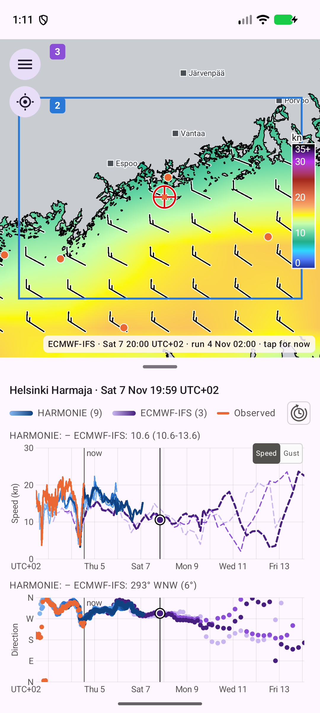

# Charts

**Tap anywhere on the map** to select a point (a red crosshair marks it), or tap an orange station dot; the title then shows the station name or the coordinates. The charts show the forecast at that point from **every stored run** of every area that covers it, whether the tile is active or not.

## Reading the charts

- **Speed chart** (top): each run is one line. HARMONIE is blue and solid; ECMWF-IFS is purple and dashed. Older runs are paler, the newest is darkest. With only one model the legend reads "Forecast runs, old → new".
- **Direction chart**: shown as dots, never lines, because 359 and 1 degrees are neighbours.
- **Speed / Gust toggle**: small switch in the corner of the speed chart. Gust exists only for HARMONIE; the switch is greyed out where no run has gust.
- **Observed wind** from a tapped station is drawn in orange.

If the runs lie close together the forecast is consistent. A wide fan means uncertainty.

## The cursor and the readout

Touch a chart with **one finger** to move the cursor. The map follows the cursor in time. The line above each chart reads, for example:

`HARMONIE: 12.2 (11.1-13.0)  ECMWF-IFS: 15.2 (11.1-15.2)  Observed: 13.2`

Before you touch the chart the models show a dash (–).

For each model it shows the value of the newest run covering that time, and in brackets the lowest and highest of all runs covering it, then the observation.

## Legend

The legend shows each model with its number of runs. **Tap an entry** to hide that model's lines, dots and readout; tap again to show it.

## Zoom

**Two fingers** zoom and pan the shared time axis. Speed rescales to what is in view and hourly ticks appear when zoomed in. **Tap for now** resets the axis.

## Auto-advance

The clock button with the circular arrow at the right end of the legend moves the cursor, and so the map, forward by itself: a quarter of an hour per quarter second, from the cursor (or from now) to the end of the axis in view. A touch on a chart, the button again, or "now" stops it.

## Units

Speed is shown in knots or m/s ([Settings](settings.md)). Times show the phone's UTC offset, for example `UTC+02`.
