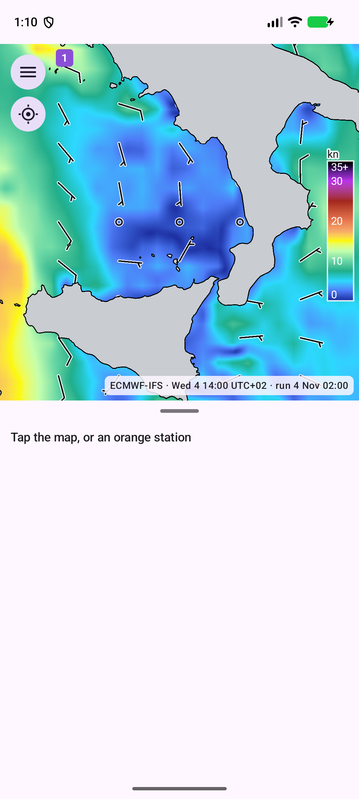
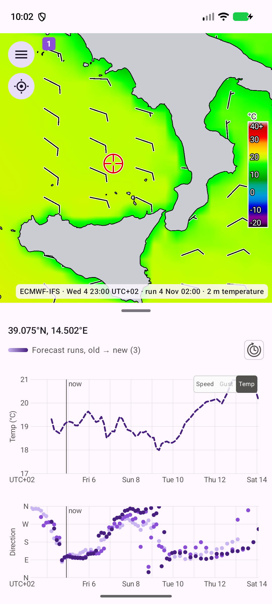

# The map

## What you see

- **Wind layer**: colours show wind speed, from blue (calm) through green, yellow, orange and red to purple and black (35 knots and more). Wind barbs show direction and speed in knots. The layer is opaque.
- **Colour bar** with the numbers inside it.
- **Temperature map**: choose **Temp** on the toggle in the speed chart and the colours show the 2 m air temperature from -20 °C (black) through purple, blue, cyan, green, yellow and orange to red and light grey at 40 °C and above (the `nipy_spectral` scale), with its own colour bar in °C. The wind barbs stay. ARPEGE and ECMWF-IFS have temperature, HARMONIE does not: the colours come from ARPEGE where it covers the point and otherwise from ECMWF-IFS, and the barbs from the topmost model, so where a HARMONIE tile lies over one of them the colours come from that one and the barbs from HARMONIE; a HARMONIE tile with nothing under it shows barbs only. The grey land setting is kept as it is, so with grey land on, the temperature shows over the sea only. Choose **Speed** to go back to the wind layer.

- **Coastline**: grey land with a black shoreline, drawn from a bundled vector map, so no map tiles are needed and the map works offline.
- **Place names**: small names of larger towns; more appear as you zoom in.
- **Station dots**: orange dots are observation stations ([Stations](stations.md)); small when zoomed out, larger when zoomed in.
- **Tile outlines**: the borders of your areas, with a number badge. Solid means active, dashed means paused or stopped. Blue is HARMONIE, green is ARPEGE, purple is ECMWF-IFS.

Zoom runs from level 5 to 15. Drag to pan, pinch to zoom.

## The caption

The caption at the bottom of the map reads, for example, `ECMWF-IFS · Sat 7 20:00 UTC+02 · run 4 Nov 02:00 · tap for now`: the model, the forecast time shown and the model run it comes from. In the temperature map it also says "2 m temperature" and, where the barbs come from another model, "wind barbs FMI-HARMONIE". For a tapped point it names the model that covers the point, and adds "also ECMWF-IFS" when a second model reaches it too. When a point is selected, tap the caption (**tap for now**) to put the chart cursor at the actual time of day; the map shows the nearest forecast hour.

## Old data fades

A tile whose newest run is more than 24 hours old fades to grey, fully grey at 48 hours. Grey means the data is stale, usually because downloads are paused or failing.

## Two models together

The finest model is drawn on top: ECMWF-IFS below ARPEGE below HARMONIE, so you see the fine model where it exists and the coarser ones around it. To look at a layer that is covered, hide the ones above it by tapping their names in the chart legend ([Charts](charts.md)).

## Location button

The button under the menu button finds your position (one fix; GPS if you allowed precise location), selects that point as if you had tapped it, and centres the map there. The position is not stored or sent anywhere.

## Divider

Between map and charts there is a drag handle. Portrait: map above, charts below. Landscape: map on the left, charts on the right. Each orientation remembers its own split.
