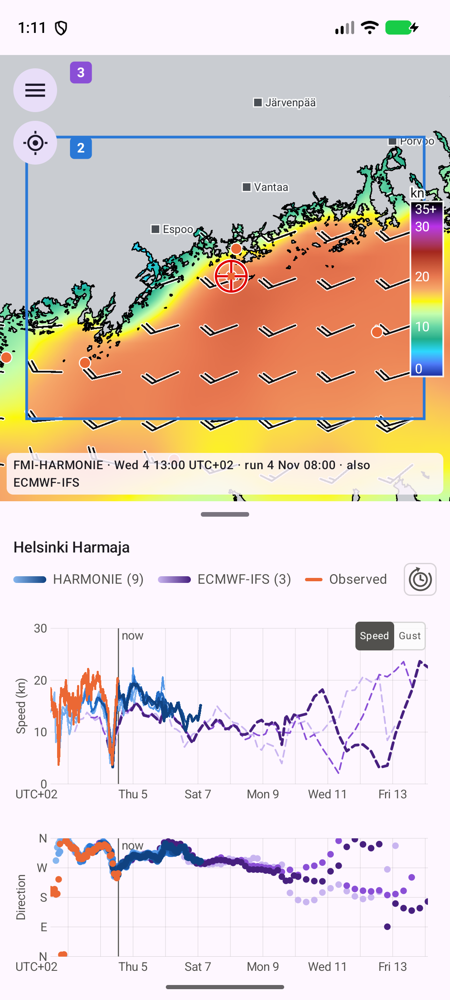

# Stations

The small orange dots on the map are marine observation stations. Tap one to see its **measured wind** drawn on the charts together with the forecasts, so you can see how well recent runs matched reality.

## Sources

| Source | Data |
|---|---|
| FMI | 10-minute observations |
| Marine Helsinki | Kruunuvuorenselkä |
| SMHI (Sweden) | hourly |
| DMI (Denmark) | 10-minute; gust is the highest 3-second mean |
| TalTech | Tallinnamadal, latest values only |
| Estonian Environment Agency | current wind only, as a text label |

Estonian stations and Tallinnamadal show only the wind of the moment as a label on the map, not a chart, because those sources offer no history. Where a source has no gust or direction, those lines are left out. A gap in the line means the station was silent.

Station dots are 2 dp in a wide view and grow to 12 dp from zoom level 10.
