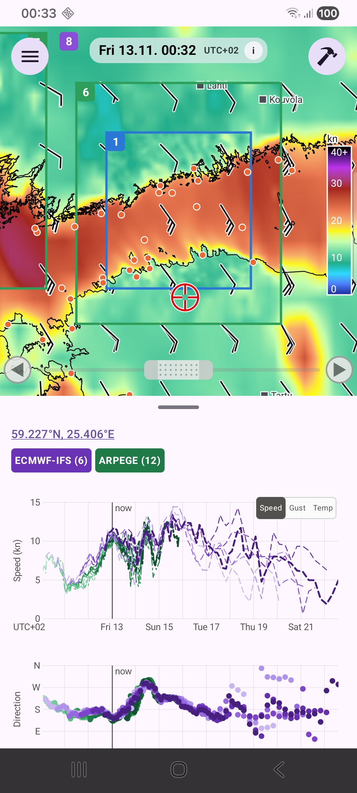
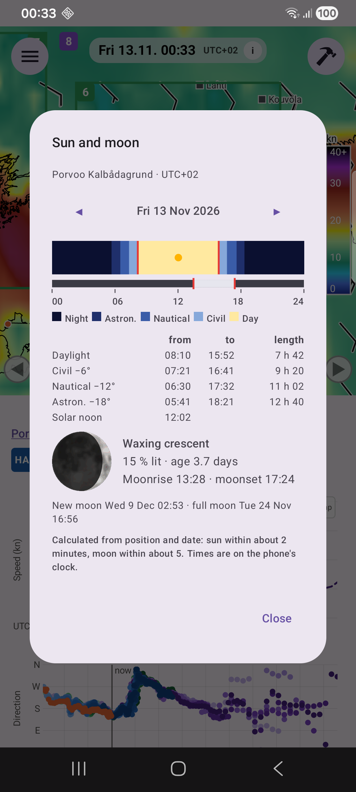

# Kaaviot

**Napauta karttaa mistä tahansa** valitaksesi pisteen (punainen ristikko merkitsee sen), tai napauta oranssia asemapistettä; otsikossa näkyy silloin aseman nimi tai koordinaatit. Kaaviot näyttävät ennusteen kyseisessä pisteessä **jokaisesta tallennetusta ajosta** kaikilta pisteen kattavilta alueilta, olipa alue aktiivinen tai ei.

## Kaavioiden lukeminen

- **Nopeuskaavio** (ylhäällä): jokainen ajo on yksi viiva. HARMONIE on sininen ja yhtenäinen; ARPEGE on vihreä, ja siinä on vuorotellen pitkiä ja lyhyitä katkoja; ECMWF-IFS on violetti ja katkoviivalla. Vanhemmat ajot ovat vaaleampia, uusin on tummin. Kun malleja on vain yksi, selitteessä lukee "Forecast runs, old → new".
- **Suuntakaavio**: näytetään pisteinä, ei koskaan viivoina, koska 359 ja 1 astetta ovat naapureita.
- **Speed / Gust / Temp -kytkin**: pieni kytkin nopeuskaavion kulmassa. Puuska (gust) on HARMONIEssa ja ARPEGEssa ja lämpötila (2 m ilmanlämpötila, °C) ECMWF-IFS:ssä ja ARPEGEssa; vaihtoehto on harmaana, jos yhdelläkään ajolla sitä ei ole. **Temp**-valinta muuttaa myös kartan värit lämpötilaksi (katso luku **Kartta**). Jos napautat pistettä, jota mikään lämpötilaennuste ei kata, kaavio ja kartta palaavat nopeuteen.
- **Havaittu tuuli** napautetulta asemalta piirretään oranssilla. **Temp**-valinnalla se on havaittu ilmanlämpötila (FMI:n, SMHI:n, DMI:n ja Marine Helsinki -asemat).

Jos ajot ovat lähellä toisiaan, ennuste on johdonmukainen. Leveä viuhka tarkoittaa epävarmuutta.

## Kohdistin ja lukema

Kosketa kaaviota **yhdellä sormella** siirtääksesi kohdistinta. Kartta seuraa kohdistinta ajassa. Kunkin kaavion yläpuolella oleva rivi on esimerkiksi:

`HARMONIE: 12.2 (11.1-13.0)  ARPEGE: 13.4 (12.0-14.1)  ECMWF-IFS: 15.2 (11.1-15.2)  Observed: 13.2`

Ennen kuin kosketat kaaviota, mallien kohdalla on viiva (–).

Kustakin mallista näytetään kyseisen ajanhetken kattavan uusimman ajon arvo, sulkeissa kaikkien sen kattavien ajojen pienin ja suurin arvo, ja lopuksi havainto.

## Selite

Selite näyttää kunkin mallin nimen lihavoituna ja viivojensa värisenä sekä ajojen määrän, ja "Observed" oranssilla. **Napauta nimeä** piilottaaksesi mallin: sen viivat, pisteet ja lukema poistuvat kaavioista, ja sen **karttakerros, tuulinuolet ja kuvateksti poistuvat kartalta**, jolloin näet toisen kerroksen alle jäävän kerroksen. Napauta uudestaan näyttääksesi ne. Nimet ovat harmaita, kun malli on piilotettu. Toisen pisteen valinta näyttää taas kaiken.

## Zoomaus

**Kahdella sormella** zoomataan ja siirretään yhteistä aika-akselia. Nopeusakseli skaalautuu näkyvään osaan ja tuntitikit ilmestyvät lähennettäessä. **Tap for now** palauttaa akselin.

## Automaattinen eteneminen

Kartan alareunan säätimen päissä olevat kaksi nuolta siirtävät kohdistinta ja siten karttaa eteen- tai taaksepäin itsestään: neljännestunnin neljännessekunnissa, kohdistimesta (tai nykyhetkestä) tallennettujen ennusteiden loppuun. Säätimen kahvan vetäminen, nuoli uudestaan (käynnissä se näyttää taukomerkkiä) tai kaksi napautusta aikaruutuun pysäyttää sen ([Kartta](map.md)).

## Aurinko ja kuu

Kaavioiden yläpuolella otsikossa oleva paikka, koordinaatit tai aseman nimi, on alleviivattu: **napauta sitä** nähdäksesi auringon ja kuun kyseisessä paikassa.

{ width=320 }

- Ikkuna avautuu kaavion kohdistimen päivään tai tähän päivään. Vasen ja oikea nuoli siirtävät yhden päivän kerrallaan, ja **Today** palauttaa tähän päivään.
- **Vuorokausijana** kulkee keskiyöstä keskiyöhön ja on väritetty sen mukaan, kuinka syvällä horisontin alapuolella aurinko on: yö, tähtitieteellinen, merenkulullinen ja siviilihämärä sekä päivä. Punaiset merkit osoittavat auringonnousun ja -laskun, piste on aurinkokeskipäivä, ja janan alla oleva palkki näyttää, milloin kuu on ylhäällä; kuun nousu ja lasku on merkitty punaisella.
- **Taulukko** kertoo päivänvalon pituuden (auringonnoususta laskuun) sekä siviili-, merenkulku- ja tähtitieteellisen päivän pituuden: aika, jolloin aurinko on yli 6, 12 tai 18 astetta horisontin alapuolella, on hämärää, joten kunkin lajin pimeä aika on loput vuorokaudesta. Missä aurinko ei ylitä jotakin tasoa, kuten Itämeren kesäyönä, taulukossa lukee "all day" tai "never".
- **Kuu** piirretään sellaisena kuin se sinä päivänä näyttää (käännettynä eteläisellä pallonpuoliskolla), ja sen vaihe, valaistu osuus, ikä vuorokausina, kuunnousu ja kuunlasku sekä seuraava uusi- ja täysikuu kerrotaan.

Kaikki lasketaan sijainnista ja päivämäärästä, joten se toimii ilman ennustetta tai verkkoyhteyttä. Aurinko on tarkka noin 2 minuutin ja kuu noin 5 minuutin tarkkuudella. Ajat ovat puhelimen kellon ja UTC-poikkeaman mukaiset, ja "päivä" on puhelimen kalenteripäivä.

## Yksiköt

Nopeus näytetään solmuina tai m/s (katso luku **Asetukset**). Ajat näytetään puhelimen UTC-poikkeamalla, esimerkiksi `UTC+02`.
