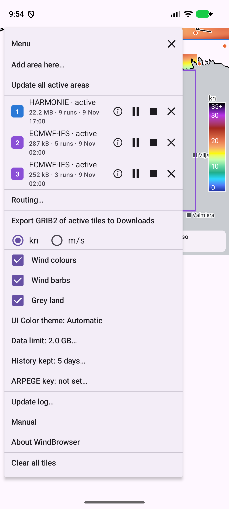

# Ensimmäinen käynnistys

Kun avaat WindBrowserin ensimmäisen kerran, kartta on tyhjä. **Mitään ei ladata ennen kuin olet valinnut alueen.**

Valikon ("hampurilaispainike" ($\equiv$), vasemmassa yläkulmassa) ylimpänä on **Add area here…** (lisää alue tähän):

{ width=320 }

## Alueen lisääminen

1. Avaa valikko kartan vasemmassa yläkulmassa olevasta **hampurilaispainikkeesta**.
2. Valitse **Add area here…**.
3. Valitse **malli**: HARMONIE (tarkka, pienet alueet) tai ECMWF-IFS (karkea, suuret alueet, hyvin pienet lataukset).
4. Nykyiseen näkymään ilmestyy suorakulmio. Vedä sen **vasenta yläkulmaa ja oikeaa alakulmaa** niin, että se peittää haluamasi merialueen. Muualle koskeminen siirtää karttaa.
5. Suorakulmion ympärillä oleva katkoviivareunus on alue, joka todellisuudessa ladataan. Se on hieman suurempi, jotta suorakulmion reunalla olevia pisteitä voidaan vielä interpoloida.
6. Tarkista paneelista **levytilaarvio** (disk estimate). Varoitus tulee, jos dataraja ylittyisi.
7. Vahvista. Ensimmäisen ennusteen lataus alkaa ("Downloading the first forecast…"). Kun data on valmis, kartan alla olevassa paneelissa lukee "Tap the map, or an orange station" (napauta karttaa tai oranssia asemaa).

!!! tip
    Purjehduskilpailua tai risteilyetappia varten valitse HARMONIE-alue reitin ympärille ja sen ympärille suurempi ECMWF-IFS-alue. Molemmat voivat olla aktiivisia yhtä aikaa.

## Kokorajat

Alue voi olla enintään 16 neliöastetta HARMONIElla ja 400 neliöastetta ECMWF-IFS:llä. Suuremmat suorakulmiot hylätään. Katso luvusta **Alueet**, mitä tapahtuu, kun alueet menevät päällekkäin.

## Mitä seuraavaksi tapahtuu

Sovellus tarkistaa uuden ennusteen taustalla tunnin välein sekä silloin, kun tuot sen etualalle (korkeintaan 10 minuutin välein). Katso luku **Päivitykset ja vianetsintä**.
