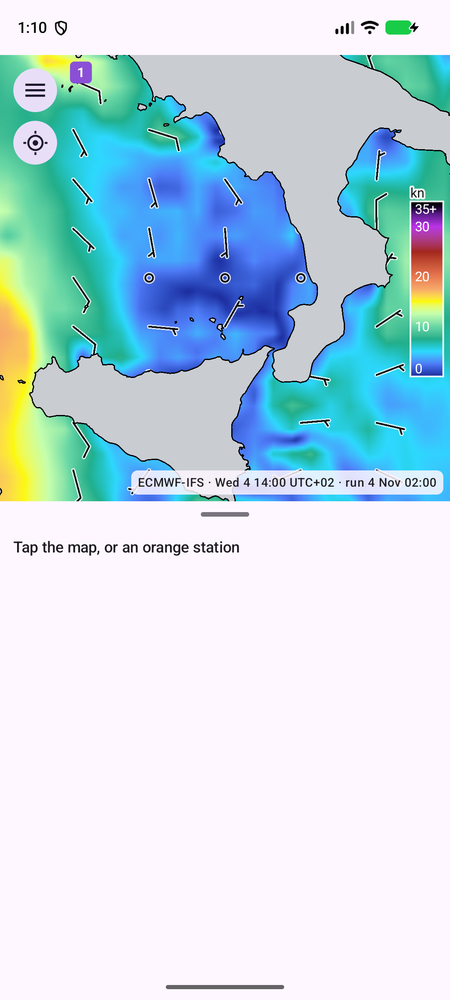
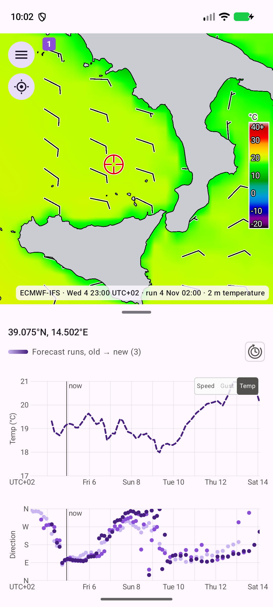

# Kartta

## Mitä näet

- **Tuulikerros** (wind layer): värit kuvaavat tuulen nopeutta sinisestä (tyyni) vihreän, keltaisen, oranssin ja punaisen kautta violettiin ja mustaan (40 solmua ja enemmän). Tuulinuolet näyttävät suunnan ja nopeuden solmuina. Kerros on läpinäkymätön.
- **Väriskaala** numeroineen.
- **Lämpötilakartta** (temperature map): valitse **Temp** nopeuskaavion kulmassa olevasta kytkimestä, niin värit näyttävät 2 metrin ilmanlämpötilan -20 °C:sta (musta) violetin, sinisen, syaanin, vihreän, keltaisen ja oranssin kautta punaiseen ja vaaleanharmaaseen 40 °C:ssa ja sen yläpuolella (`nipy_spectral`-asteikko), ja sillä on oma väriskaalansa °C:na. Tuulinuolet säilyvät. ARPEGEssa ja ECMWF-IFS:ssä on lämpötila, HARMONIEssa ei: värit tulevat ARPEGElta, missä se kattaa pisteen, ja muuten ECMWF-IFS:ltä, ja tuulinuolet ylimmältä mallilta, joten kun HARMONIE-alue on jommankumman päällä, värit tulevat sieltä ja tuulinuolet HARMONIElta; HARMONIE-alue, jonka alla ei ole mitään, näyttää vain tuulinuolet. Harmaa maa -asetus säilyy ennallaan, joten kun harmaa maa on päällä, lämpötila näkyy vain merialueella. Valitse **Speed** palataksesi tuulikerrokseen.

- **Rantaviiva**: harmaa maa ja musta rantaviiva, piirretty mukana tulevasta vektorikartasta, joten karttalaattoja ei tarvita ja kartta toimii ilman verkkoyhteyttä.
- **Paikannimet**: suurempien kaupunkien pienet nimet; lisää tulee näkyviin, kun lähennät.
- **Asemapisteet**: oranssit pisteet ovat havaintoasemia (katso luku **Havaintoasemat**); pieniä loitonnettaessa, suurempia lähennettäessä.
- **Aluerajat**: alueidesi reunat numeromerkillä. Yhtenäinen viiva tarkoittaa aktiivista, katkoviiva tauolla tai pysäytettyä aluetta. Sininen on HARMONIE, vihreä ARPEGE, violetti ECMWF-IFS.

Zoomaustaso vaihtelee välillä 5–15. Siirrä karttaa vetämällä, zoomaa nipistämällä.

## Kuvateksti

Kuvateksti (näkyviin aikaruudun pienellä (i)-painikkeella, ruudun alle) on esimerkiksi `ECMWF-IFS · Sat 7 20:00 UTC+02 · run 4 Nov 02:00`: malli, näytettävä ennusteaika ja ajo, josta ennuste on peräisin. Lämpötilakartassa siinä lukee lisäksi "2 m temperature" ja, kun tuulinuolet tulevat toiselta malliltä, "wind barbs FMI-HARMONIE". Napautetulle pisteelle se nimeää pisteen kattavan mallin ja lisää "also ECMWF-IFS", kun toinenkin malli yltää siihen. Kaksi napautusta aikaruutuun tai säätimen kahvaan siirtää kartan ja kaavion kohdistimen todelliseen kellonaikaan.

## Vanha data haalenee

Alue, jonka uusin ajo on yli 24 tuntia vanha, haalenee harmaaksi ja on täysin harmaa 48 tunnin kohdalla. Harmaa tarkoittaa vanhentunutta dataa, yleensä siksi, että lataukset ovat tauolla tai epäonnistuvat.

## Kaksi mallia yhdessä

Tarkin malli piirretään päällimmäiseksi: ECMWF-IFS ARPEGEn alle ja ARPEGE HARMONIEn alle, joten näet tarkan mallin siellä missä se on ja karkeammat sen ympärillä. Nähdäksesi peittyneen kerroksen piilota sen päällä olevat napauttamalla niiden nimiä kaavioiden selitteessä (luku **Kaaviot**).

## Työkalupainike

Kartan oikeassa yläkulmassa oleva pyöreä vasaranappi sisältää kolme työkalua. Napauta sitä, niin sadetutka-, reititys- ja paikannuspainike aukeavat sen ympärille; käytä yhtä napauttamalla sitä. Napauta vasaraa uudelleen tai mitä tahansa muuta kohtaa kartalla sulkeaksesi ne. Valikkopainike vasemmalla ylhäällä pysyy paikallaan.

- **Sadetutka** (rain radar): kytkee tutkakerroksen päälle ja pois (katso alla).
- **Reititys** (siksak-reitti, jonka kummassakin päässä on piste): avaa saman ikkunan kuin valikon **Routing**: reittisi, tallennetut suunnitelmat ja "Plan a passage" ([Reititys](routing.md)).
- **Paikannus**: hakee sijaintisi (yksi paikannus; GPS, jos sallit tarkan sijainnin), keskittää kartan siihen ja asettaa siihen punaisen **sijaintineulan**, ja valitsee lisäksi pisteen kuin olisit napauttanut sitä (kaaviot näyttävät sen ennusteen). Neula pysyy kartalla, kun napautat muualle. Napauta neulaa valitaksesi sen pisteen uudelleen ja avataksesi tunnisteen, jossa on sijainti ja kartan ajan ennuste (esimerkiksi `33.8 kn, gust 41.4 kn, 299° WNW, 09:55`; se seuraa aikaa, kun selaat); neulan viereen tulee pyöreä sulkemispainike, jota napauttamalla neula poistuu. Neulan uusi napautus tai mikä tahansa muu piste tai asema kartalla sulkee tunnisteen mutta jättää neulan. **Paikannus**-painikkeen uusi painallus siirtää neulan uuteen sijaintiin. Sijaintia ei tallenneta eikä lähetetä minnekään, ja neula katoaa, kun sovellus käynnistetään uudelleen.

## Sadetutka

Tutkapainike on sininen, kun kerros on päällä, ja harmaa, kun se on pois. Päälle kytkettynä se näyttää FMI:n sadetutkakuvan (Suomi ja ympäristö) kellon ajalta ja siirtää ajan nykyhetkeen. Tutkan näkyessä se korvaa tuuli- tai lämpötilakerroksen ja sen väriskaalan, eikä aikaa voi siirtää nykyhetken ohi; kytke tutka pois saadaksesi ennusteen takaisin. Viimeisen 6 tunnin kuvat ladataan päälle kytkettäessä (yksi 15 minuutin välein), joten ajan selaaminen ei tarvitse verkkoyhteyttä. Värit vaihtelevat sinisestä tummanpunaiseen sateen voimistuessa (0,1 mm/h ja jopa 5 mm/h ja enemmän); harmaampi sävy ja ohut viiva osoittavat, mihin tutkat eivät yllä. Siellä missä sadetta ei ole, kuva on merenvärinen: vaalea vaaleassa teemassa ja keskiharmaa tummassa.

## Aikaruutu ja säädin

Kartan ja kaavioiden aika, joka on aina sama, näkyy kartan yläreunassa himmeästi läpinäkyvässä ruudussa: päivä ja kellonaika isolla ja UTC-siirtymä pienellä sen vieressä. Ruutu muuttuu keltaiseksi, kun aika on yli minuutin päässä nykyhetkestä. **Kaksoisnapautus** siirtää ajan nykyhetkeen. Ruudun sisällä oleva pieni (i)-painike näyttää kartan kuvatekstin (ruudun alla); se piiloutuu, kun napautat karttaa tai kaavioita.

Kartan alareunan säätimessä on nuolipainike lähellä kumpaakin näytön reunaa, himmeä viiva niiden välissä ja kahva keskellä. Aika on ylhäällä, jotta sormi ei peitä sitä säädettäessä.

- Nuoli kummassakin päässä käyttää aikaa eteen- tai taaksepäin itsestään (neljännestunti neljännessekunnissa); käynnissä oleva nuoli muuttuu taukomerkiksi. Toisen nuolen painaminen kääntää suunnan.
- **Vedä kahvaa** oikealle tai vasemmalle muuttaaksesi aikaa: aika kulkee eteen- tai taaksepäin niin kauan kuin pidät kahvaa poissa keskeltä, sitä nopeammin mitä pidemmälle vedät (enintään 60 dp; nopeus vaihtelee 20 ennusteminuutista sekunnissa nelinkertaiseksi). Kahva palaa keskelle, kun päästät irti. Painikkeet ja viiva pysyvät paikallaan. Vaaleassa teemassa kahvalla on ohut harmaa reunaviiva, ja pieni teksti "tap twice for now" sen yläpuolella muistuttaa kaksoisnapautuksesta.
- **Vedä kahva aivan viivan päähän** (kumpaan tahansa), niin kahva hyppää siihen päähän: aika etenee silloin 6 tunnin hypyin, yksi sekunnissa, puhelimen ajan merkkeihin 00:00, 06:00, 12:00 ja 18:00 (kello 16:34 eteenpäin mentäessä askeleet ovat 18:00, 00:00, 06:00 ja niin edelleen; kello 20:32 ensimmäinen on 00:00). Siirrä sormi takaisin kohti keskustaa, niin kahva palaa normaalialueelleen ja normaaliin nopeuteen; päästä irti, niin se palaa keskelle ja aika pysähtyy. Tämä toimii ennusteessa; tutkan säätimessä ei ole jousta.
- **Kaksoisnapautus** kahvaan siirtää ajan nykyhetkeen.

## Jakaja

Kartan ja kaavioiden välissä on vedettävä kahva. Pystysuunnassa: kartta ylhäällä, kaaviot alhaalla. Vaakasuunnassa: kartta vasemmalla, kaaviot oikealla. Kumpikin suunta muistaa oman jakonsa. Tabletilla ja missä tahansa vähintään 840 dp:n levyisessä ikkunassa (myös avattu taittuva puhelin tai jaettu näyttö) kartta ja kaaviot ovat vierekkäin kuten vaakasuunnassa.
