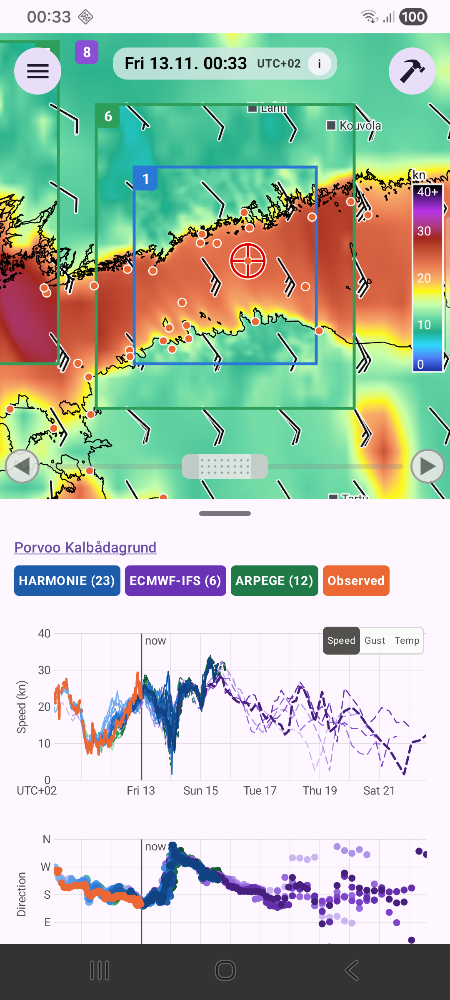

# Havaintoasemat

Kartan pienet oranssit pisteet ovat merellisiä havaintoasemia. Napauta pistettä nähdäksesi sen **mitatun tuulen** (ja, jos asemalla on lämpömittari, **ilmanlämpötilan** Temp-kaaviossa) piirrettynä kaavioihin ennusteiden rinnalle, jolloin näet, kuinka hyvin viimeaikaiset ajot osuivat todellisuuteen.

## Lähteet

| Lähde | Data |
|---|---|
| FMI | 10 minuutin havainnot |
| Marine Helsinki | Kruunuvuorenselkä |
| SMHI (Ruotsi) | tunneittain |
| DMI (Tanska) | 10 minuutin; puuska on suurin 3 sekunnin keskiarvo |
| TalTech | Tallinnamadal, vain viimeisimmät arvot |
| Viron ympäristövirasto | 12 rannikkoasemaa: 10 minuutin historia (virasto säilyttää vain noin 3,7 vuorokautta); muut asemat: vain nykyinen tuuli, tekstimerkintänä |

Tallinnamadal ja ne Viron asemat, jotka eivät kuulu 12 rannikkoasemaan, näyttävät vain hetkellisen tuulen tekstinä kartalla, eivät kaaviota, koska nämä lähteet eivät tarjoa historiaa. Kaavio ei ulotu kauemmas kuin napautetun pisteen vanhin ennuste. Jos lähteellä ei ole puuskaa tai suuntaa, kyseiset viivat jätetään pois. Katko viivassa tarkoittaa, että asema oli hiljaa.

Asemapisteet ovat 2 dp laajassa näkymässä ja kasvavat 12 dp:hen zoomaustasosta 10 alkaen.
